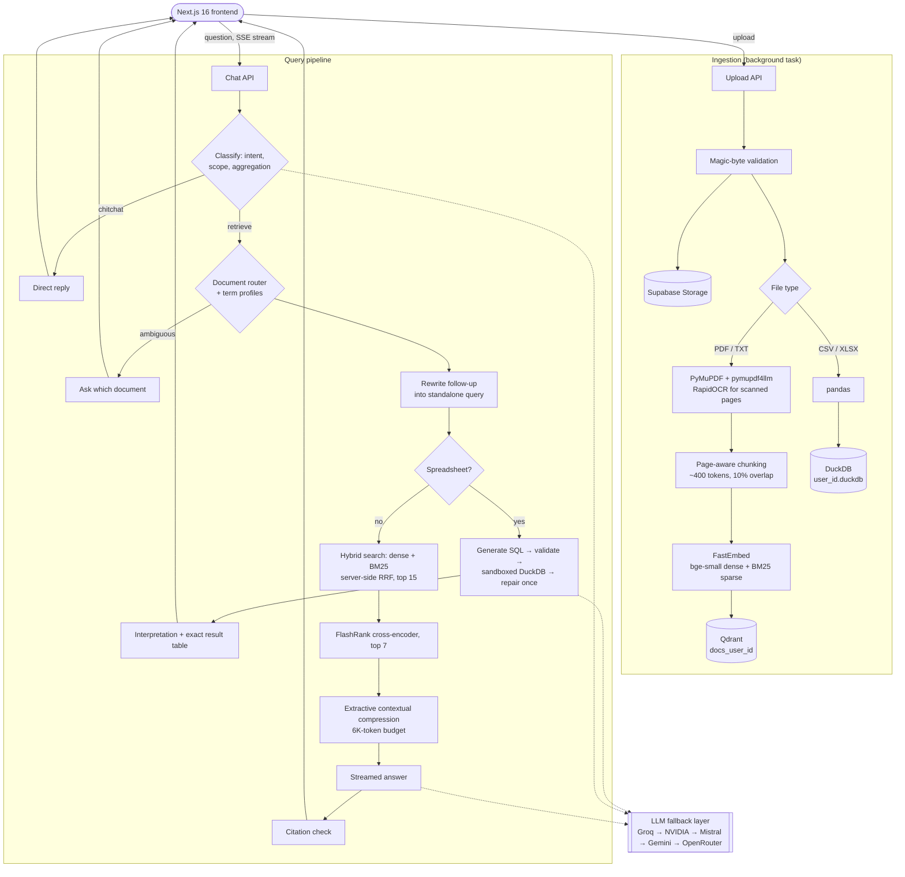

# DocTalk — Hybrid RAG + Text-to-SQL Document Assistant

[](https://github.com/YashMittal1503/RAG-PROJECT/actions/workflows/ci.yml)
[](LICENSE)


DocTalk is a full-stack, multi-tenant assistant for asking questions about your own files. Upload PDFs, text files and spreadsheets, ask in plain English, and get a streamed answer grounded in your documents, with page citations for text and the exact SQL and result table for spreadsheets.

It is built without LangChain or LlamaIndex: every stage of the pipeline (parsing, chunking, hybrid retrieval, reranking, compression, routing, Text-to-SQL, LLM failover) is plain, tested Python, and it ships with its own evaluation harness to measure each stage.

---

## Highlights

| | |
|---|---|
| **Two answer engines** | Unstructured files go through hybrid RAG (dense + BM25, Reciprocal Rank Fusion, cross-encoder reranking). Spreadsheets go through Text-to-SQL on a sandboxed, per-user DuckDB. |
| **LLM routing at every step** | One classifier call decides intent (chitchat or retrieval), scope (whole document, section, metadata, specific fact) and whether the question aggregates. A document router picks which file a question is about, or asks the user when it's ambiguous. |
| **Resilient multi-provider LLM layer** | Five providers (Groq → NVIDIA NIM → Mistral → Gemini → OpenRouter), any number of API keys each, per-model rate-limit cooldowns, daily-quota detection and failover in milliseconds instead of SDK retry loops. |
| **Security by design** | Magic-byte file validation, macro-enabled Office files rejected, LLM-written SQL run in a read-only DuckDB with file and network access disabled at the engine level, per-user data isolation everywhere. |
| **Measured, not guessed** | A golden-set evaluation harness (103 hand-verified questions over 10 documents) scores retrieval, routing, citations, refusals, Text-to-SQL, latency, an LLM judge and RAGAS, with bootstrap confidence intervals. |
| **Production plumbing** | Async FastAPI with SSE streaming, Postgres via SQLAlchemy 2 + Alembic, Supabase Auth (JWKS JWT verification), Logfire tracing with secret masking, Docker, GitHub Actions CI and image publishing. |

---

## Architecture



---

## How it works

### 1. Ingestion

Uploads are validated, stored in Supabase Storage and processed by a background task that moves each document through `queued → parsing → chunking → embedding → ready` (or `failed` with a readable reason, and a retry button in the UI). Jobs that were interrupted by a restart are marked failed on startup instead of hanging forever.

- **PDF parsing in three tiers:** `pymupdf4llm` for layout-aware Markdown (multi-column reading order, tables), plain PyMuPDF text as a fallback, and RapidOCR (ONNX) for scanned, image-only pages.
- **Page-aware, token-bounded chunking:** sentences are packed into ~400-token chunks (512 max, the embedding model's window) with ~10% overlap, never crossing a page boundary, so every chunk has an exact page to cite. Abbreviations like `Dr.` and `e.g.` don't split sentences.
- **Dual embeddings, locally:** FastEmbed computes a 384-dim dense vector (`BAAI/bge-small-en-v1.5`) and a sparse BM25 vector for every chunk on CPU via ONNX. No embedding API costs.
- **Spreadsheets are not embedded.** Each sheet becomes a DuckDB table (`t_<doc>_<sheet>`). Column names are made into plain SQL identifiers (originals kept as column comments) and ISO-date text columns become real `DATE`/`TIMESTAMP` columns.
- **Memory-aware:** ingestion is serialized and embeds in small batches so it fits a 1 GB / 2 vCPU instance; models load lazily and the OCR engine is unloaded after use.

### 2. Understanding the question

- **Query classification** — one fast LLM call returns `intent`, `scope` (`global`, `section`, `metadata`, `targeted`) and `aggregation`. Greetings skip retrieval; aggregation questions on spreadsheets go to SQL. It is measured separately with `python -m eval classify`.
- **Document routing** — with several files in a library, the router resolves the target document from an `@mention`, a filename in the question, the document the conversation is already about, a reply to a clarification question, or an LLM call over a catalog of the files. When the question is genuinely ambiguous ("summarize the document"), it asks which file instead of guessing.
- **Content-aware routing** — filenames alone aren't enough ("Where is Lily's hometown?" names no file). `doc_profiles.py` builds a profile of each document's distinctive names and terms (frequent, capitalized, and rare in the other documents) from chunks already in Qdrant, with no extra LLM call; spreadsheets are described by their sheets and columns.
- **Query rewriting** — follow-ups like "what about his salary?" are rewritten into standalone search queries using the chat history.

### 3. Hybrid retrieval (text documents)

- Qdrant runs a **dense + BM25 hybrid query with server-side Reciprocal Rank Fusion** in one `query_points` call, filtered to the routed document. Dense vectors catch meaning and paraphrase; BM25 catches exact names, IDs and numbers.

  $$\mathrm{RRF}(d) = \sum_{m \in \{\text{dense},\,\text{bm25}\}} \frac{1}{k + r_m(d)}$$

- The top 15 candidates are reranked by a **FlashRank cross-encoder** (`ms-marco-TinyBERT-L-2-v2`, ONNX, ~3 MB) down to 7.
- **Extractive contextual compression** keeps only the query-relevant sentences of each chunk (keyword and bigram overlap, synonym expansion, ±1 sentence of surrounding context, `[...]` between excerpts), then packs chunks into a 6,000-token budget. Short chunks and chunks with no overlap pass through untouched, and the `[Page N]` tags survive, so citations still work. This keeps prompts under free-tier tokens-per-minute limits.
- The answer streams token by token over SSE. The prompt requires grounded answers with `[Page N]` / `[Rows a-b]` citations and an explicit "not in the documents" when the context doesn't contain the answer. Cited pages are then checked against the chunks that were actually retrieved before they are shown as sources.

### 4. Text-to-SQL (spreadsheets)

1. The LLM sees a Markdown profile of the tables: column types, value ranges, the allowed values of category columns, the share of missing values, and sample rows.
2. Whole-dataset questions ("what's in this file?") are answered from that profile without SQL. Everything else gets one DuckDB `SELECT`/`WITH` query, generated with a hint about whether the question aggregates.
3. **The SQL sandbox:** the connection is read-only with `enable_external_access=false` and `lock_configuration=true`, so a prompt-injected `read_text('.env')`, `COPY`, `ATTACH` or `INSTALL httpfs` can't touch the server. On top of that: exactly one statement, a keyword deny-list checked with string literals removed (so `WHERE status = 'Deleted'` is fine), `CAST` → `TRY_CAST` for dirty cells, a 15-second timeout and a 100-row cap.
4. If the query fails, the LLM gets the error and repairs it once. If it still fails, the answer falls back to the profile and is told not to invent numbers.
5. The LLM writes a short interpretation and the **exact result table is appended by code**, so the model never retypes (or mistypes) numbers. The UI shows the executed SQL.

### 5. The LLM fallback layer

`app/services/llm_provider.py` makes free-tier and rate-limited APIs usable in production:

```
request ──► Groq (gpt-oss-120b, qwen3) ──► NVIDIA NIM (Nemotron, MiniMax) ──► Mistral ──► Gemini Flash ──► OpenRouter
              key 1 · key 2 · key 3 …        key 1 · key 2 …                     …            …              …
```

- **Key pools:** any number of keys per provider (`GROQ_API_KEY`, `GROQ_API_KEY_2`, … `_N`, or a comma-separated `GROQ_API_KEYS`), used round-robin.
- **Error classification:** `429` rate limits, daily quotas, `413` / context-too-large and retired models (`404`, "decommissioned") are told apart from the status code, headers and message, and each is handled differently.
- **Cooldowns per (key, model):** Groq's free limits are per model, so a limited key keeps serving its other models. The wait comes from `Retry-After` / `x-ratelimit-reset-*` headers or "try again in 7m4s" text; daily limits wait until the provider's reset time (midnight Pacific for Gemini).
- **Shared-account detection:** when Groq names the same organization for several keys, they're cooled together instead of burning one 429 per key.
- **Healthy keys first, everywhere:** every ready key on every tier is tried before any key that's still cooling down; only then are cooling keys retried, soonest recovery first.
- **Requests that can't fit are skipped, not retried:** a request larger than a provider's per-request ceiling (8K tokens on Groq free) goes straight to the next tier without cooling keys.
- **No SDK retry stalls:** every client uses `max_retries=0`, so failover takes milliseconds. Failures before the first streamed token re-route transparently; a provider dropping mid-stream ends the answer with a notice instead of breaking the SSE connection.
- **Separate fast and generation chains:** classification, rewriting and SQL use smaller, faster models; answers use the larger ones. Reasoning models get a larger token budget.
- Keys are masked (`gsk_...9cYD`) in every log line and trace.

### 6. Security and multi-tenancy

- **Authentication:** Supabase JWTs verified locally against the project's JWKS (ES256/RS256), with the legacy HS256 secret and the Supabase Auth API as fallbacks, plus a short-lived LRU cache of verified tokens.
- **Isolation:** every query is scoped to the authenticated user: one Qdrant collection (`docs_<user_id>`), one DuckDB file, one storage folder and row-level ownership checks on every Postgres query.
- **Uploads:** file type is read from magic bytes, not the extension; macro-enabled files (`.xlsm`, `.xlsb`, `.xltm`, `.docm`) are rejected; size and batch limits; storage paths use only the file's base name.
- **Connection safety:** the streaming endpoint uses short scoped DB sessions, so a long generation never holds a Postgres connection.

---

## Evaluation

Quality is tracked with the harness in [`backend/eval/`](backend/eval/README.md), which runs the same functions as the chat endpoint against an isolated eval tenant (its own Qdrant collection and DuckDB file).

- **Golden set:** 103 hand-verified items over 10 documents (two novels, a research paper, an annual report, a Python handbook, business documents and three spreadsheets), in categories such as single fact, multi-hop, global summary, multi-turn, table/figure, Text-to-SQL, routing and unanswerable. Every evidence quote is checked against the corpus by `python -m eval validate`; LLM-drafted questions (`python -m eval draft`) are tagged for human review.
- **Metrics, layer by layer:** evidence recall@k, MRR, nDCG, citation precision/recall, correct and false refusals, route / document / scope / aggregation accuracy, SQL execution and result match, latency and token use; plus an LLM judge (answer correctness, key-point recall) and RAGAS 0.4 (faithfulness, answer relevancy, context precision, context recall).
- **Comparable runs:** bootstrap 95% confidence intervals, paired run-vs-run comparison, per-category and per-document breakdowns, judge calibration against human labels (Cohen's κ), a judge from a different provider than the generator, and on-disk caches so re-scoring is free.
- **HTML dashboard:** `python -m eval view <run> [<other run>]`.

### Results

Two runs on the same 103-item golden set: a baseline, and the current pipeline after adding content-aware document routing, the routing guard for spreadsheets and the quota-aware LLM layer.

| Metric | Baseline | Current |
|---|---:|---:|
| Document routing accuracy | 0.71 | **0.97** |
| Answer-route accuracy (RAG / SQL / chitchat / clarify) | 0.80 | **0.97** |
| Query scope accuracy | 0.97 | **0.98** |
| SQL executed | 0.48 | **0.91** |
| SQL result matches gold | 0.43 | **0.67** |
| Evidence recall@10 | 0.58 | **0.65** |
| MRR | 0.40 | **0.46** |
| Citation precision | 0.45 | **0.56** |
| False refusals on answerable questions | 0.16 | **0.08** |
| Correct refusals on unanswerable questions | 0.83 | 0.83 |
| Latency p50 | 9.5 s | **2.7 s** |

The baseline run was also scored by the LLM judge and RAGAS (judge: NVIDIA Nemotron, a different provider from the Groq generator): judge correctness 0.63, RAGAS faithfulness 0.78, answer relevancy 0.90, context recall 0.69. The current run was scored offline (no judge), so its judge and RAGAS scores aren't reported here yet. Run outputs are kept out of git; reproduce with `python -m eval run --system vanilla`.

---

## Tech stack

| Layer | Technology |
|---|---|
| Backend | Python, FastAPI (async), Pydantic v2, Server-Sent Events |
| Retrieval | Qdrant Cloud (dense + sparse, server-side RRF), FastEmbed (`bge-small-en-v1.5`, BM25), FlashRank cross-encoder |
| Parsing | PyMuPDF, pymupdf4llm, RapidOCR (ONNX), pandas, openpyxl, tiktoken |
| Tabular | DuckDB (embedded, sandboxed, per user) |
| LLMs | Groq, NVIDIA NIM, Mistral, Google Gemini, OpenRouter (OpenAI-compatible clients) |
| Data | Supabase Postgres (SQLAlchemy 2 async + Alembic), Supabase Storage, Supabase Auth |
| Evaluation | Custom harness, RAGAS 0.4, LLM-as-judge with calibration |
| Observability | Pydantic Logfire (OpenTelemetry): FastAPI, httpx and OpenAI instrumentation, spans per pipeline stage |
| Frontend | Next.js 16 (App Router), React 19, TypeScript, Tailwind CSS v4, react-markdown |
| DevOps | Docker, GitHub Actions (tests, lint, build; image pushed to GHCR), EC2 auto-deploy with Watchtower |

---

## Project structure

```
.
├── backend/
│   ├── app/
│   │   ├── main.py              # app, lifespan, middleware, Logfire
│   │   ├── auth.py              # Supabase JWT verification
│   │   ├── routers/             # documents, chat (SSE), health
│   │   ├── services/            # query, llm_provider, tabular_qa, tabular_store, ingestion,
│   │   │                        # parsing, chunking, embedding, vector_store, reranker, doc_profiles
│   │   └── utils/               # file validation, memory release
│   ├── alembic/                 # database migrations
│   ├── eval/                    # evaluation harness, golden set, scorers, dashboard
│   ├── scripts/                 # re-index existing documents
│   └── tests/                   # 235 tests
├── frontend/                    # Next.js app (login, dashboard, streaming chat)
├── .github/workflows/           # CI and Docker image publishing
├── docker-compose.yml
└── setup_ec2.sh                 # one-time EC2 setup (Docker, swap, Watchtower)
```

---

## Getting started

### Prerequisites

- Python 3.11+ and Node.js 20+
- A [Supabase](https://supabase.com) project (Postgres, Auth, and a private Storage bucket named `documents`)
- A [Qdrant Cloud](https://cloud.qdrant.io) cluster
- At least one LLM key. Groq is the primary tier; NVIDIA NIM, Mistral, Gemini and OpenRouter are optional fallbacks (a missing provider is simply skipped).

### Backend

```bash
cd backend
python -m venv venv
venv\Scripts\activate                # macOS/Linux: source venv/bin/activate
pip install -r requirements.txt
cp .env.example .env                 # fill in the values below
alembic upgrade head
uvicorn app.main:app --reload --port 8000
```

Main variables (see [`backend/.env.example`](backend/.env.example) for all of them):

```dotenv
SUPABASE_URL=https://your-project.supabase.co
SUPABASE_KEY=your-service-role-key
DATABASE_URL=postgresql+asyncpg://...pooler.supabase.com:6543/postgres
QDRANT_URL=https://your-cluster.cloud.qdrant.io:6333
QDRANT_API_KEY=...
GROQ_API_KEY=gsk_...                 # add GROQ_API_KEY_2, _3, ... for more keys
NVIDIA_API_KEY=nvapi-...             # optional fallback tiers
MISTRAL_API_KEY=...
GEMINI_API_KEY=...
OPENROUTER_API_KEY=...
LOGFIRE_TOKEN=                       # optional: send traces to Logfire
FRONTEND_URL=http://localhost:3000
```

### Frontend

```bash
cd frontend
npm ci
cp .env.example .env.local           # NEXT_PUBLIC_SUPABASE_URL, NEXT_PUBLIC_SUPABASE_ANON_KEY, NEXT_PUBLIC_API_URL
npm run dev                          # http://localhost:3000
```

### Docker

```bash
docker compose up --build            # backend on http://localhost:8000
```

---

## Testing

```bash
cd backend
pytest tests -q
```

235 tests run in under a minute with no network access or API keys: LLM clients, Qdrant and storage are mocked. They cover key rotation and cooldowns, cross-provider failover (streaming and non-streaming, including mid-stream failures), error classification, query classification, document routing and clarification, the spreadsheet routing guard, the SQL sandbox and validator, Text-to-SQL planning, chunking, PDF parsing and OCR fallback, compression, hybrid search, file validation, chat titles and the evaluation harness itself.

CI (GitHub Actions) runs the backend tests and the frontend lint and production build on every push and pull request; pushes to `main` also build the backend Docker image and publish it to GHCR, where Watchtower on the EC2 host picks it up.

---

## Design decisions

- **No orchestration framework.** Each stage is a small function that can be tested and measured on its own, and the eval harness calls exactly the same code as the API.
- **SQL for numbers, RAG for prose.** Embedding spreadsheet rows makes "total revenue by region" a guessing game; running SQL makes it exact.
- **Code renders the numbers.** The LLM interprets the SQL result, but the table the user sees comes straight from DuckDB.
- **Local embeddings and reranking.** Small ONNX models on CPU keep ingestion free and private and let the backend run on a 1 GB instance.
- **Fail over, don't wait.** On free tiers a 429 is normal; moving to another key or provider is faster than any backoff.

---

## License

[MIT](LICENSE)
